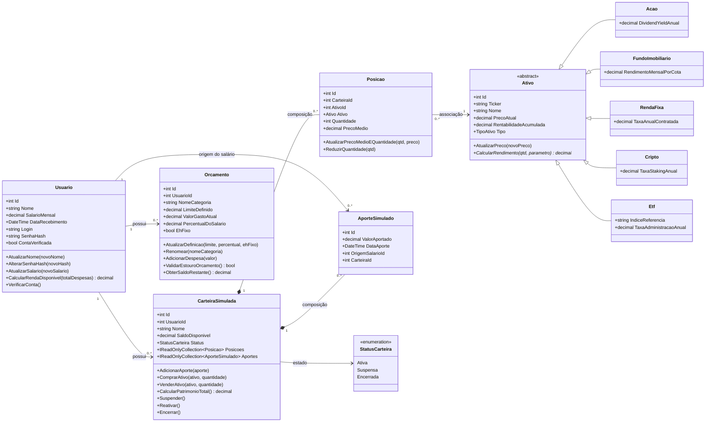

# Modelo de classes — Portfy

Modelo **conceitual** das classes de domínio implementadas hoje. Não é uma cópia
do esquema do banco (`docs/diagrama.md` §4 descreve a persistência) nem do código
linha a linha: descreve responsabilidades, atributos e operações relevantes.

Regra de manutenção: toda classe citada aqui existe em `Models/` e todo membro
citado existe no código. Divergência é defeito — a correção é no documento ou no
código, nunca "deixar para depois".

## 1. Diagrama

## 2. Correspondência com o código (B02)

| Classe do modelo | Arquivo | Observação |
|---|---|---|
| `Usuario` | `Models/Usuario.cs` | identidade, login, salário, verificação de conta |
| `CarteiraSimulada` | `Models/CarteiraSimulada.cs` | agregado raiz da simulação |
| `Posicao` | `Models/CarteiraSimulada.cs` (fim do arquivo) | declarada no mesmo arquivo do agregado |
| `Ativo` | `Models/Ativos/Ativo.cs` | abstrata |
| `Acao` | `Models/Ativos/Acao.cs` | subtipo |
| `FundoImobiliario` | `Models/Ativos/FundoImobiliario.cs` | subtipo |
| `RendaFixa` | `Models/Ativos/RendaFixa.cs` | subtipo |
| `Cripto` | `Models/Ativos/Cripto.cs` | subtipo |
| `Etf` | `Models/Ativos/Etf.cs` | subtipo |
| `AporteSimulado` | `Models/AporteSimulado.cs` | entrada de dinheiro datada |
| `Orcamento` | `Models/Orcamento.cs` | limite e gasto por categoria |
| `StatusCarteira` | `Models/StatusCarteira.cs` | enumeração de estado |

**Não existe** `Models/Posicao.cs`. A classe `Posicao` é declarada dentro de
`Models/CarteiraSimulada.cs`. Versões anteriores deste modelo diziam que o arquivo
"existe e está comentado" — a afirmação estava errada e foi corrigida aqui.

## 3. Atributos, métodos e o que cada um garante (B03)

| Classe | Método relevante | Comportamento (não é get/set) |
|---|---|---|
| `CarteiraSimulada` | `ComprarAtivo` | valida estado ativo, saldo suficiente, atualiza posição com preço médio ponderado e debita o saldo — sob `_lock` |
| `CarteiraSimulada` | `VenderAtivo` | valida estado, quantidade em posse, credita saldo e remove a posição quando zera |
| `CarteiraSimulada` | `CalcularPatrimonioTotal` | soma saldo + `quantidade × preço` das posições |
| `CarteiraSimulada` | `Suspender` / `Reativar` / `Encerrar` | transições do estado nomeado, recusando as proibidas |
| `Posicao` | `AtualizarPrecoMedioEQuantidade` | recalcula o preço médio ponderado |
| `Posicao` | `ReduzirQuantidade` | recusa remover mais do que existe |
| `Ativo` | `AtualizarPreco` | valida preço > 0 e recalcula `RentabilidadeAcumulada` percentual |
| `Ativo` | `CalcularRendimento` (abstrato) | contrato polimórfico: cada subtipo aplica sua fórmula |
| `Orcamento` | `AdicionarDespesa` | recusa valor ≤ 0 e acumula o gasto |
| `Usuario` | `AtualizarSalario`, `CalcularRendaDisponivel` | valida salário ≥ 0 e calcula renda livre |

Os setters são `private set` (ou `protected set` em `Ativo`, para o EF); nenhuma
propriedade de `Models/` tem `set` público.

## 4. Contrato polimórfico (B06)

| Item | Conteúdo |
|---|---|
| Contrato | `Ativo.CalcularRendimento(int quantidade, decimal taxaOuParametro)` — abstrato |
| Implementação 1 | `Acao` — provento mensal pelo dividend yield: `preço × qtd × (DY/100)/12` |
| Implementação 2 | `FundoImobiliario` — rendimento por cota: `qtd × RendimentoMensalPorCota` |
| Implementação 3 | `RendaFixa` — juros mensais sobre o valor investido |
| Implementação 4 | `Cripto` — staking mensal; zero quando não há taxa |
| Implementação 5 | `Etf` — variação do índice menos taxa de administração |
| Uso pela aplicação | `Services/AtivoService.CalcularRendimentoEstimado` chama `ativo.CalcularRendimento(...)` sobre a referência `Ativo`, exposto em `GET api/ativo/{ticker}/rendimento` |

## 5. Associações e multiplicidades (B04)

| Associação | Multiplicidade | Implementação |
|---|---|---|
| `Usuario` → `CarteiraSimulada` | 1 para 0..* | FK `UsuarioId` em `Carteiras`, `OnDelete(Cascade)`; índice único `(UsuarioId, Nome)` |
| `Posicao` → `Ativo` | 0..* para 1 | FK `AtivoId` em `Posicoes`, `OnDelete(Restrict)` — apagar um ativo não apaga histórico |
| `Usuario` → `AporteSimulado` | 1 para 0..* | FK `OrigemSalarioId`, `OnDelete(Restrict)` |
| `Usuario` → `Orcamento` | 1 para 0..* | FK `UsuarioId`, índice único `(UsuarioId, NomeCategoria)` |

A multiplicidade **não** substitui as regras: o índice único é a rede de segurança
de R4, não a regra em si (ver `requisitos.md` §3).

## 6. Composição e ciclo de vida (B05)

`CarteiraSimulada` **compõe** `Posicao`:

- no domínio, a coleção é `private readonly List<Posicao> _posicoes` exposta como
  `IReadOnlyCollection<Posicao>`; quem cria a posição é `ComprarAtivo` e quem a
  remove é `VenderAtivo` quando a quantidade zera;
- na persistência, `HasMany(c => c.Posicoes).WithOne().OnDelete(Cascade)`;
- a posição não tem existência fora da carteira: `Posicao.VincularCarteira` é
  `internal` e só o agregado chama.

`AporteSimulado` é composição **no domínio** (só entra por `AdicionarAporte`), mas
`OnDelete(Restrict)` no banco: histórico financeiro não é descartado em cascata.
Essa diferença é intencional e está documentada em `docs/diagrama.md` §4.
