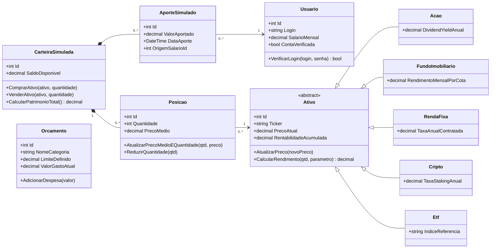
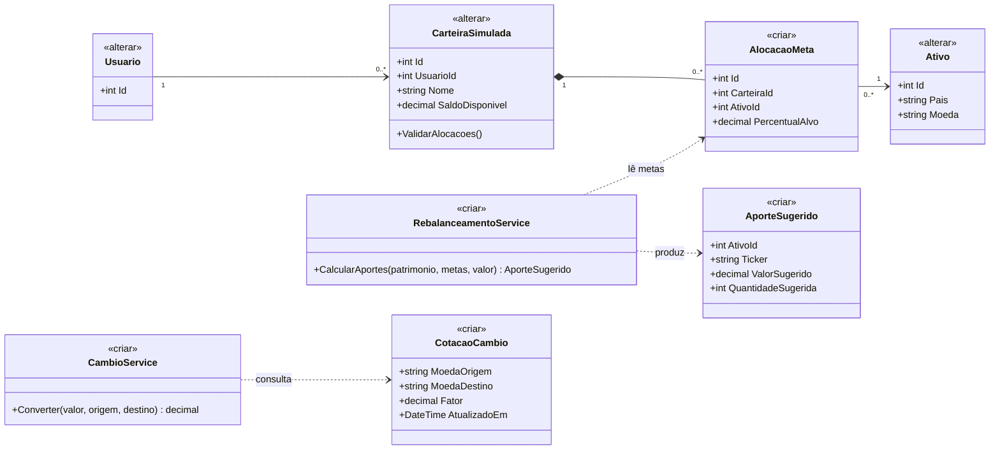
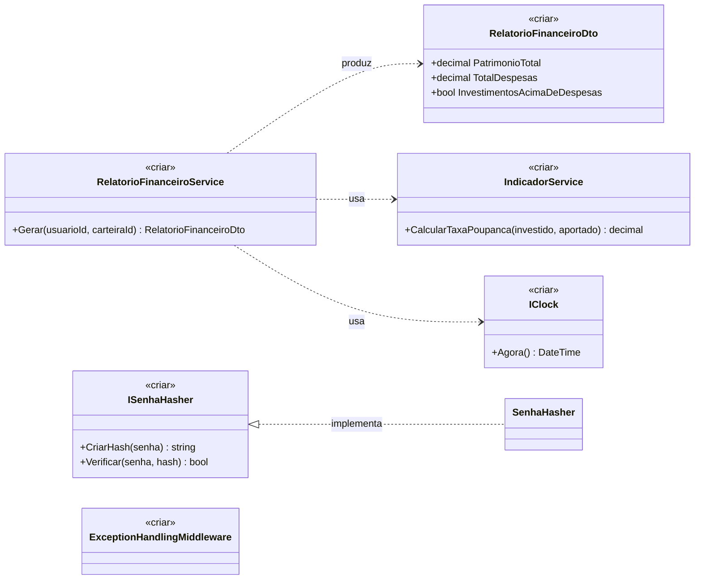

# Diagrama de Classes — Candidatas

Documento de trabalho que transforma as decisões de `docs/arch.md` em **classes concretas**: o que já existe, o que precisa mudar e o que ainda vai ser criado, com responsabilidade, relações e ordem de implementação.

- **Baseline de código:** verificado em **2026-11-01** por leitura dos arquivos; toda classe marcada como `existe` foi conferida no código, não presumida. Gates e dívida ficam em `docs/arch.md` §4 e §20.
- **Autoridade de schema:** `docs/arch.md` §9.1. Este documento não decide schema — ele lista as classes que implementam aquele schema, na granularidade de um diagrama de classes.
- **Autoridade de escopo funcional:** `notas/importante/sugestoes_mvp_portfy_temp_outubro_2026.md`.
- **Autoridade de dívida e gates:** `docs/arch.md` §20 e §18. Não repetidos aqui.

---

## 1. Como ler

| Estado | Significado |
|---|---|
| `existe` | Classe no código, no arquivo indicado. |
| `alterar` | Classe existe, mas falta atributo ou relação exigida por uma funcionalidade do MVP. |
| `criar` | Classe não existe; é candidata. |
| `fora` | Deliberadamente **não** será criada (ver §9). |

Regra: **candidata não é compromisso**. Uma classe só é aprovada quando a funcionalidade que a exige entra no escopo. Criar classe sem consumidor é o mesmo erro que criar `IFooService` sem injeção (`arch.md` §3.2, ADR-013).

Notação das ondas (§8): `1` = pré-requisito de todas as outras, `5` = borda/serviço sem dependente novo.

---

## 2. Núcleo atual — o que o diagrama já tem

| Classe | Arquivo | Papel | Relação |
|---|---|---|---|
| `Usuario` | `Models/Usuario.cs` | identidade, login, salário | 1 → N `CarteiraSimulada` (**relação a criar**) |
| `CarteiraSimulada` | `Models/CarteiraSimulada.cs` | agregado: saldo + posições + aportes | compõe `Posicao` e `AporteSimulado` |
| `Posicao` | `Models/CarteiraSimulada.cs` | quantidade e preço médio de um ativo | associa `Ativo` |
| `AporteSimulado` | `Models/AporteSimulado.cs` | entrada de dinheiro datada | FK para `Usuario` (`OrigemSalarioId`) |
| `Orcamento` | `Models/Orcamento.cs` | limite e gasto por categoria | sem dono hoje |
| `Ativo` (abstrata) | `Models/Ativos/Ativo.cs` | cotação, rentabilidade, rendimento | superclasse de 5 subtipos |
| `Acao`, `FundoImobiliario`, `RendaFixa`, `Cripto`, `Etf` | `Models/Ativos/` | polimorfismo de `CalcularRendimento` | TPH com discriminador `Tipo` |
| `TipoAtivo` | `Models/Ativos/TipoAtivo.cs` | enum de categoria | usado como discriminador |

Detalhe relevante: `Posicao` está declarada **dentro** de `Models/CarteiraSimulada.cs` e `Models/Posicao.cs` está inteiro comentado (`arch.md` P2-b). As FKs `AtivoId` e `CarteiraSimuladaId` existem hoje como *shadow properties* em `Data/Configurations/` — ver §3.

---

## 3. Alterações em classes existentes (vêm antes das novas)

Toda classe nova depende de uma FK que hoje não existe no domínio. Por isso estas alterações vêm primeiro — sem elas, `AlocacaoMeta` e `CotacaoCambio` não têm onde se pendurar.

| Classe | O que falta | Por que (funcionalidade) | Origem |
|---|---|---|---|
| `CarteiraSimulada` | `UsuarioId`, `Nome` | múltiplas simulações por usuário e seletor de perfil | `arch.md` §2.2 (múltiplas simulações), §9.1 |
| `CarteiraSimulada` | composição de `AlocacaoMeta` | pizza de alocação | §2.2, §9.2 |
| `Posicao` | `CarteiraId` (hoje shadow `CarteiraSimuladaId`) e `AtivoId` (hoje shadow) | promover FK implícita a propriedade explícita | `Data/Configurations/PosicaoConfiguration.cs` |
| `Posicao` | extrair para `Models/Posicao.cs` e apagar o arquivo comentado | coesão de arquivo; uma classe por arquivo | §20 P2-b |
| `Posicao` | `ValorAtual()` | o cálculo `Quantidade * Ativo.PrecoAtual` está duplicado em `CarteiraSimulada.CalcularPatrimonioTotal` e em `RelatorioFinanceiro` | `arch.md` §6.2 |
| `AporteSimulado` | `CarteiraId` (hoje shadow `CarteiraSimuladaId`, anulável) | aporte deixa de ser opcionalmente órfão | `AporteSimuladoConfiguration.cs` |
| `Orcamento` | `UsuarioId`, `EhFixo` | orçamento por usuário; despesa fixa × variável | §2.2 (orçamentos fixos vs. variáveis), §9.1 |
| `Ativo` | `Pais`, `Moeda` | ativos globais e conversão de moeda | §2.2 (conversão de moedas), §9.1 |

Observação de modelagem: `Posicao.ValorAtual()` não é enfeite. Hoje a mesma conta existe em dois lugares e cada consumidor novo a repetiria — a correção de raiz é a posição ser dona do próprio valor, e os relatórios apenas somarem.

---

## 4. Classes novas

### 4.1 `AlocacaoMeta` — `Models/AlocacaoMeta.cs`

| Item | Definição |
|---|---|
| Responsabilidade | Percentual-alvo de **um** ativo dentro de **uma** carteira. |
| Campos | `Id`, `CarteiraId`, `AtivoId`, `PercentualAlvo` (`decimal`) |
| Invariantes | `PercentualAlvo` entre `0` e `100`; par `(CarteiraId, AtivoId)` único |
| Relações | *—1 `CarteiraSimulada` (composição), *—1 `Ativo` (associação) |
| Estado | `criar` · onda 2 |

A invariante "as metas somam 100 ± 0,01" **não** pertence a esta classe: ela precisa do conjunto inteiro e por isso é dona `CarteiraSimulada` (mesmo padrão de `Posicao`, que compõe e é composta). `AlocacaoMeta` valida só a própria faixa.

### 4.2 `AporteSugerido` — `Models/AporteSugerido.cs`

| Item | Definição |
|---|---|
| Responsabilidade | Resultado imutável do rebalanceamento: quanto comprar de cada ativo. Não é entidade — não tem `Id`, não é persistido. |
| Campos | `AtivoId`, `Ticker`, `ValorSugerido`, `QuantidadeSugerida` |
| Forma | `sealed record` (como `Services/VariacaoSimulada.cs`, o precedente existente) |
| Estado | `criar` · onda 2 |

### 4.3 `RebalanceamentoService` — `Services/RebalanceamentoService.cs`

| Item | Definição |
|---|---|
| Responsabilidade | Regra pura que cruza patrimônio atual × metas × valor do aporte e devolve quanto comprar de cada ativo. |
| Assinatura canônica | `CalcularAportes(patrimonioAtualPorAtivo, metas, valorAporte) → IReadOnlyList<AporteSugerido>` |
| Proibições | Sem I/O, sem `DbContext`, sem `Random`, sem `DateTime.Now`. Determinístico e testável sem banco. |
| Dependências | `AlocacaoMeta`, `AporteSugerido` |
| Estado | `criar` · onda 2 · `arch.md` §11.5 |

O arredondamento do resíduo segue `arch.md` §11.4: ordenar por percentual-alvo decrescente, arredondar e atribuir o resto à primeira alocação. Nunca por ordem de inserção.

### 4.4 `CotacaoCambio` — `Models/CotacaoCambio.cs`

| Item | Definição |
|---|---|
| Responsabilidade | Fator de conversão explícito e datado entre duas moedas. |
| Campos | `Id`, `MoedaOrigem`, `MoedaDestino` (ISO 4217), `Fator` (`decimal`), `AtualizadoEm` |
| Invariantes | `Fator > 0`; par `(MoedaOrigem, MoedaDestino)` único |
| Estado | `criar` · onda 3 · ADR-015 (atualização manual, sem API externa) |

### 4.5 `CambioService` — `Services/CambioService.cs` (+ `ICambioService`)

| Item | Definição |
|---|---|
| Responsabilidade | Única função de conversão da aplicação. |
| Método | `Converter(valor, moedaOrigem, moedaDestino) → decimal` |
| Falha | Câmbio ausente **falha** (`422`), nunca assume fator `1.0` (`arch.md` §11.8) |
| Estado | `criar` · onda 3 |

### 4.6 `RelatorioFinanceiroService` + DTO

| Item | Definição |
|---|---|
| Responsabilidade | Consolidar carteira, orçamentos e aportes em um DTO de leitura. |
| Substitui | `Services/RelatorioFinanceiro.cs`, que imprime em `Console` (`arch.md` ADR-012 / P2-a) |
| DTOs | `RelatorioFinanceiroDto`, `PosicaoResumoDto`, `OrcamentoResumoDto`, `IndicadorPoupancaDto` em `Dtos/` |
| Estado | `criar` (DTOs) e `alterar`/`substituir` (serviço) · onda 4 |

O relatório é **leitura**: não altera estado, não persiste, não formata moeda no backend (formatação é do SPA, `arch.md` §11.2). Visão macro (investimentos × despesas) e micro (por ativo e por categoria) saem do **mesmo** DTO — duas consultas, não duas classes de relatório.

### 4.7 `IndicadorService` — `Services/IndicadorService.cs`

| Item | Definição |
|---|---|
| Responsabilidade | Taxa de poupança: quanto do aporte total simulado virou investimento. |
| Método | `CalcularTaxaPoupanca(totalInvestido, totalAportado) → decimal` |
| Estado | `criar` · onda 4 · `arch.md` §2.2 |

Fórmula em um único lugar, determinística e coberta por teste de borda (`totalAportado == 0`).

### 4.8 Contratos e infraestrutura

| Classe / interface | Arquivo | Papel | Estado |
|---|---|---|---|
| `IClock` | `Services/Contracts/IClock.cs` | remove `DateTime.Now` do domínio; data determinística em teste | `criar` · onda 2 · `arch.md` §3.2, P2-d |
| `ISenhaHasher` | `Services/Contracts/ISenhaHasher.cs` | tirar PBKDF2 de `Models/Usuario.cs` | `criar` · onda 5 · §13.5 |
| `SenhaHasher` | `Services/SenhaHasher.cs` | implementação de `ISenhaHasher`, ≥ 210k iterações | `criar` · onda 5 · P1-d |
| `ExceptionHandlingMiddleware` | `Middleware/ExceptionHandlingMiddleware.cs` | traduz exceção → `ProblemDetails` em um único ponto | `criar` · onda 5 · ADR-005 |
| `Dtos/<Recurso>Dto` | `Dtos/` | contrato de entrada/saída tipado (hoje a pasta não existe) | `criar` · onda 5 · ADR-004 |

`ISenhaHasher` só entra quando `Usuario` deixar de fazer hash — interface sem consumidor é proibida (§3.2).

---

## 5. Tabela-resumo

| Classe | Camada | Tipo | Estado | Exigida por | Onda |
|---|---|---|---|---|---|
| `AlocacaoMeta` | `Models/` | entidade | `criar` | pizza de alocação / rebalanceamento | 2 |
| `AporteSugerido` | `Models/` | record | `criar` | rebalanceamento automático | 2 |
| `RebalanceamentoService` | `Services/` | serviço puro | `criar` | rebalanceamento automático | 2 |
| `IClock` | `Services/Contracts/` | contrato | `criar` | determinismo de data | 2 |
| `CotacaoCambio` | `Models/` | entidade | `criar` | ativos globais | 3 |
| `CambioService` | `Services/` | serviço | `criar` | conversão de moedas | 3 |
| `RelatorioFinanceiroService` | `Services/` | serviço de leitura | `criar` | visão consolidada | 4 |
| `RelatorioFinanceiroDto` e resumos | `Dtos/` | DTO | `criar` | visão consolidada | 4 |
| `IndicadorService` | `Services/` | serviço puro | `criar` | taxa de poupança | 4 |
| `ISenhaHasher` / `SenhaHasher` | `Services/` | contrato + serviço | `criar` | coesão de `Usuario` | 5 |
| `ExceptionHandlingMiddleware` | `Middleware/` | middleware | `criar` | contrato de erro | 5 |
| `CarteiraSimulada` | `Models/` | entidade | `alterar` | múltiplas simulações | 1 |
| `Posicao` | `Models/` | entidade | `alterar` | valor atual / FKs explícitas | 1 |
| `AporteSimulado` | `Models/` | entidade | `alterar` | aporte vinculado à carteira | 1 |
| `Orcamento` | `Models/` | entidade | `alterar` | orçamento por usuário, fixo × variável | 1 |
| `Ativo` | `Models/` | entidade abstrata | `alterar` | ativos globais | 3 |

---

## 6. Diagramas das candidatas

### 6.1 Posse, alocação e câmbio

### 6.2 Leitura, indicadores e contratos

---

## 7. Regras de modelagem que toda candidata deve respeitar

Valem para qualquer classe nova, sem exceção (`arch.md` §13 e §16):

1. Entidade persistida tem **dois construtores**: o de domínio (valida) e o protegido sem parâmetros (só para o EF).
2. `Id` é `public int Id { get; private set; }`. `get;` puro impede materialização e é proibido.
3. Nenhum `{ get; set; }` público em `Models/` — conquista da AV1, não pode regredir.
4. Coleção exposta como `IReadOnlyCollection<T>`; lista interna `private readonly`.
5. Invariante fica em **método de domínio**, não só no construtor: objeto vindo do banco nunca pode violar invariante.
6. Dinheiro é `decimal`; arredondamento em um único helper `Math.Round(v, 2, MidpointRounding.AwayFromZero)`.
7. Modelo não acessa `AppDbContext`, `IConfiguration`, `Random` ou `Clock` estáticos, nem cria hash de senha.
8. Mapeamento com mais de 3 linhas vai para `Data/Configurations/<Entidade>Configuration.cs`, aplicado por assembly.
9. Nome de classe no singular, em pt-BR para o domínio (`AlocacaoMeta`, não `Alocacoes`); `Service`/`Dto`/`Middleware` como sufixo nas outras camadas.
10. Sem `IRepository<T>`, sem repositório genérico, sem camada extra (ADR-013).

---

## 8. Ordem de implementação (ondas)

A ordem não é preferência estética: cada onda destrava a seguinte, porque a nova classe precisa da FK da anterior.

| Onda | Conteúdo | Destrava |
|---|---|---|
| **1** | `UsuarioId`/`Nome` em `CarteiraSimulada`; FKs explícitas em `Posicao` e `AporteSimulado`; `UsuarioId`/`EhFixo` em `Orcamento` | múltiplas simulações, orçamento por usuário |
| **2** | `AlocacaoMeta`, `AporteSugerido`, `RebalanceamentoService`, `IClock` | rebalanceamento automático e simulador "e se?" (preview sem escrita) |
| **3** | `Pais`/`Moeda` em `Ativo`, `CotacaoCambio`, `CambioService` | ativos globais e visão unificada por moeda |
| **4** | `RelatorioFinanceiroService`, DTOs, `IndicadorService` | gráfico macro/micro e taxa de poupança |
| **5** | `Dtos/` por recurso, `ExceptionHandlingMiddleware`, `SenhaHasher`/`ISenhaHasher` | contrato de API estável e erro uniforme |

Cada onda termina com migration + testes das invariantes que introduziu — uma onda não abre sem a anterior verde (`arch.md` §21).

---

## 9. O que **não** é candidata

Listado para não ser "implementado por engano" no futuro:

| Ideia | Motivo | Fonte |
|---|---|---|
| `Despesa` (lançamento datado) | adiada: no MVP o gasto é acumulador em `Orcamento` | ADR-014 |
| `Simulacao` como classe separada de `CarteiraSimulada` | "simulação" é nome de produto da carteira; criar as duas duplicaria o agregado | `arch.md` §2.3 |
| `IRepository<T>` / repositório genérico | abstração especulativa proibida; `DbContext` já é a abstração | ADR-013 |
| `AtivoHistorico` / série de preços | fora do escopo do MVP | `arch.md` §2.4 |
| `CotacaoTempoReal` / integração com API de bolsa | fora do escopo; câmbio é manual | §2.4, ADR-015 |
| `PerfilRisco`, `Notificacao`, `2FA` | não existem nas sugestões do MVP | §2.4 |
| Classe "pizza"/`Grafico` | o gráfico é renderização no SPA; nenhuma classe de domínio é exigida por ele | ADR-011 |

---

## 10. Decisões abertas

Pontos que este documento **não** fecha e que precisam de decisão antes da onda correspondente:

| # | Questão | Opções | Recomendação |
|---|---|---|---|
| 1 | A carteira tem `MoedaBase`? | (a) sim, `CarteiraSimulada.MoedaBase`; (b) não, cada ativo mantém a própria moeda e o DTO converte | **Não criar agora**: `arch.md` §9.1 não lista `MoedaBase`, e a conversão está isolada em `CambioService`. Criar só se a soma "tudo em uma moeda" exigir um valor persistido. |
| 2 | `AlocacaoMeta` aponta para `Ativo` ou para `TipoAtivo`? | (a) por ativo (schema de §9.1); (b) por classe de ativo (pizza por tipo) | **Por `Ativo`**, como manda §9.1. Pizza por tipo é agregação de leitura no DTO, não nova entidade. |
| 3 | `AporteSimulado.OrigemSalarioId` nomeia o quê? | hoje é FK para `Usuario.Id` (`AporteSimuladoConfiguration.cs:21-24`) | Renomear para `UsuarioId` ou documentar o significado. Nome que engana custa mais caro que a migration. |
| 4 | `Posicao.ValorAtual()` ou cálculo no serviço? | (a) método na entidade; (b) no `RelatorioFinanceiroService` | **(a)**: o valor da posição é regra da posição; serviço só soma. |

---

## 11. Manutenção deste documento

1. Classe candidata implementada → sai de §4/§5 como `criar` e entra em §2 como `existe`, no mesmo commit da entrega.
2. Classe descartada → vai para §9 com o motivo e a data, nunca é apagada sem rastro.
3. Funcionalidade nova entra primeiro em `notas/importante/sugestoes_mvp_portfy_temp_outubro_2026.md`; só depois aparece aqui.
4. Divergência entre este documento e `arch.md` §9.1 se resolve **a favor de `arch.md`**: aqui é a lista de trabalho, lá é a decisão.
