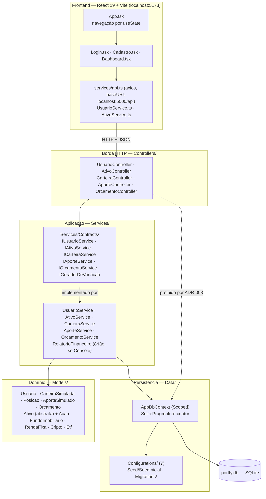
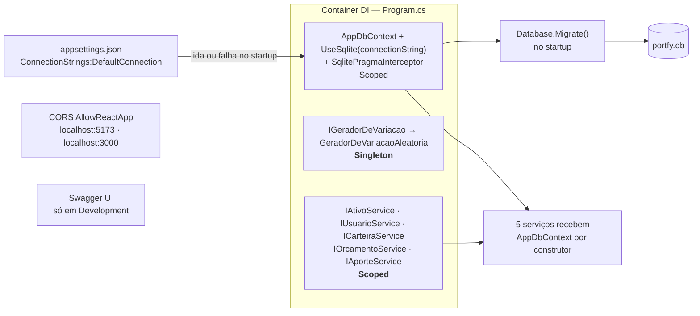
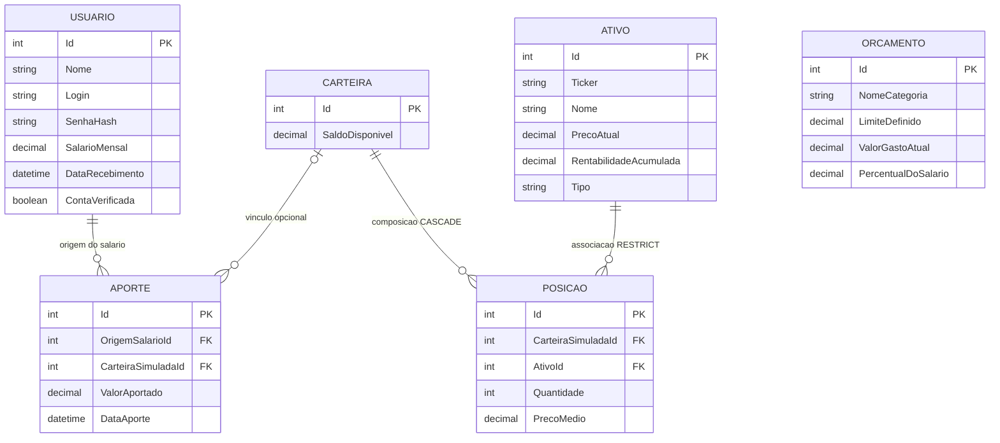
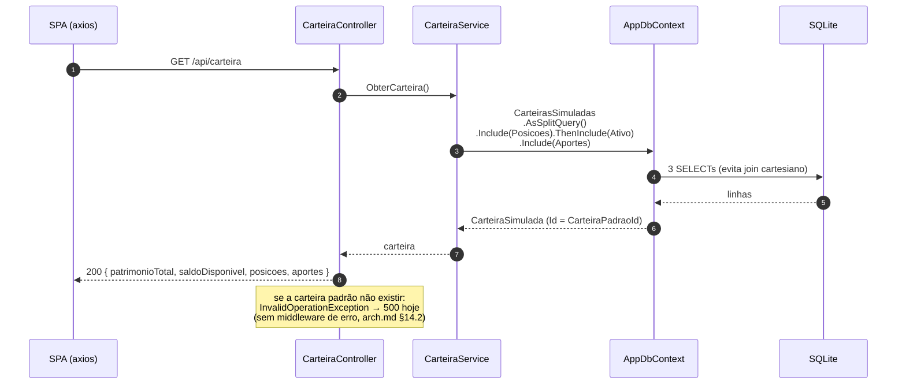
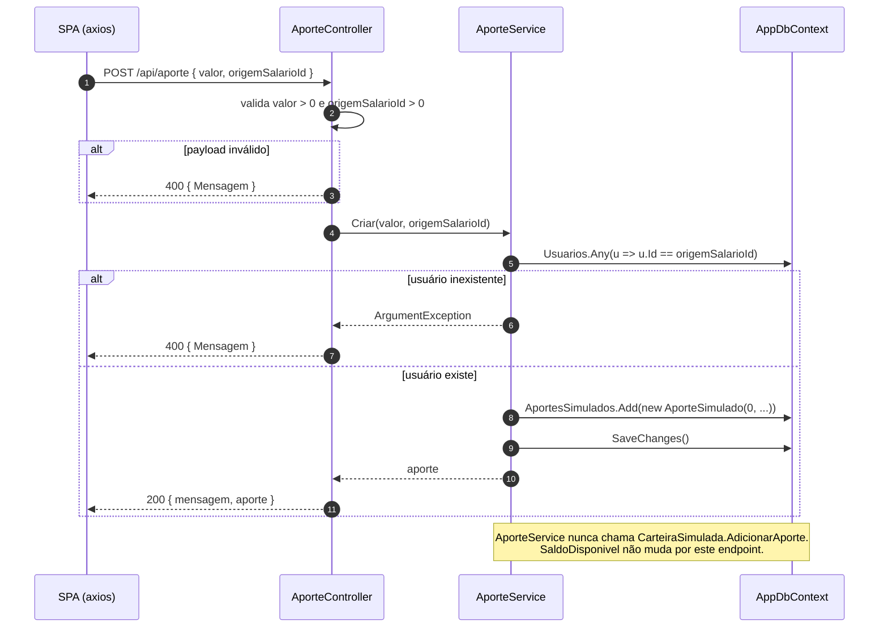
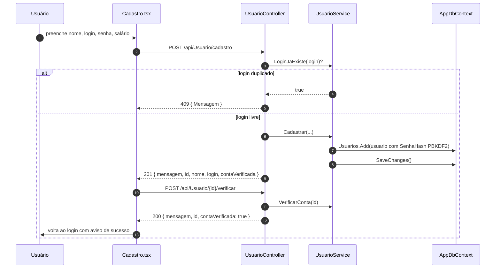
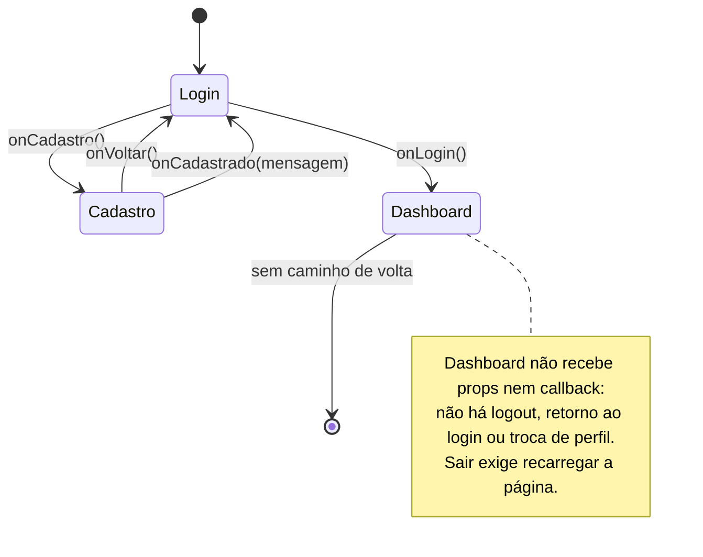

# Diagramas do Portfy

Diagramas em [Mermaid](https://mermaid.js.org/) do sistema **como ele está hoje**: arquitetura, modelo de dados persistido, fluxos de requisição e navegação do SPA.

- **Baseline:** verificado em **2026-11-01** por leitura de `Program.cs`, `Controllers/`, `Services/`, `Models/`, `Data/` e `frontend/src/`. Todo diagrama descreve código que existe; quando o código não faz algo, o diagrama mostra a ausência (§11).
- **O que não está aqui:** classes candidatas e diagrama de classes do domínio ficam em `docs/diagrama-classe-candidatas.md` (não duplicados). Regras, gates e dívida ficam em `docs/arch.md`.
- **Como renderizar:** o GitHub renderiza os blocos automaticamente. Para editar visualmente, colar o bloco em <https://mermaid.live>.

---

## 1. Como ler

| Seção | Diagrama | Responde |
|---|---|---|
| §2 | Camadas | quem pode chamar quem |
| §3 | Componentes e injeção de dependência | o que é instanciado, quando e por quem |
| §4 | Modelo de dados (ER) | quais tabelas existem e como se ligam |
| §5–§8 | Sequência | o caminho real de uma requisição |
| §9 | Estados do SPA | como o usuário navega entre telas |
| §10 | Mapa de endpoints | rota → controller → service → tabela |

Nomes de classe, rota e tabela aparecem **exatamente** como no código, inclusive a inconsistência de caixa entre rota (`api/Carteira`) e chamada do SPA (`/carteira`) — ver §11, item 5.

---

## 2. Arquitetura em camadas



Leitura do diagrama: a seta pontilhada `Controllers -.-> AppDbContext` existe **para mostrar a proibição**, não uma dependência real — `grep -rn "AppDbContext" Controllers` é vazio.

---

## 3. Componentes e injeção de dependência

`Program.cs` é o único ponto de composição (`arch.md` §7.1, item 6). Registro efetivo:



Dois fatos que o diagrama fixa: (a) a connection string tem **uma** origem e ausência dela derruba o startup; (b) só o gerador de variação é `Singleton` — todos os outros acompanham a requisição.

---

## 4. Modelo de dados persistido

Tabelas reais geradas por `Data/Migrations/20261101003441_InitialCreate`, com os nomes de `ToTable(...)`.



Ordem de exclusão importa e está no diagrama: `Posicao` morre com a carteira (`CASCADE`); `Aporte` e `Posicao`→`Ativo` **não** (`RESTRICT`) — histórico financeiro não é descartado em cascata.

Observações verificadas no mapeamento:

1. **`CarteiraSimuladaId` em `APORTE` é anulável** porque o modelo de domínio não declara essa FK (`AporteSimuladoConfiguration.cs:26-30`); é uma *shadow property*.
2. **`ATIVO` é TPH**: uma tabela, discriminador string na coluna `Tipo` (`Acao`, `Fii`, `Cripto`, `Etf`, `RendaFixa`), com as colunas de subtipo anuláveis.
3. **`ORCAMENTO` não tem dono**: nenhuma FK para `USUARIO` hoje — é o delta de modelagem já registrado (`diagrama-classe-candidatas.md` §3).
4. `Ticker` tem índice **único** e colação `NOCASE`.

---

## 5. Sequência — `GET api/Carteira`



---

## 6. Sequência — `POST api/Ativo/{ticker}/simular`

Fluxo que mais exercita as regras: borda escolhe o percentual, domínio calcula e persistência grava.

```mermaid
sequenceDiagram
    autonumber
    participant SPA as SPA (axios)
    participant C as AtivoController
    participant S as AtivoService
    participant G as IGeradorDeVariacao
    participant A as Ativo (domínio)
    participant DB as AppDbContext

    SPA->>C: POST /api/Ativo/PETR4/simular { percentualCustomizado? }
    C->>S: SimularVariacao(ticker, percentual?)
    S->>DB: FirstOrDefault(Ticker == ticker)
    DB-->>S: Ativo ou null

    alt ativo inexistente
        S-->>C: null
        C-->>SPA: 404 { Mensagem }
    else ativo encontrado
        S->>G: SortearPercentual(-5, +5)
        G-->>S: percentual
        S->>A: AtualizarPreco(preço * (1 + p/100))
        A-->>S: PrecoAtual e RentabilidadeAcumulada recalculados
        S->>DB: SaveChanges()
        S-->>C: VariacaoSimulada(ativo, precoAnterior)
        C-->>SPA: 200 { mensagem, precoAnterior, novoPreco, rentabilidadeAcumulada }
    end

    Note over A: o domínio só recebe um preço determinístico;<br/>a aleatoriedade mora na borda (arch.md §11, item 6)
```

---

## 7. Sequência — `POST api/Aporte`

Este diagrama existe para tornar visível uma limitação real: **o aporte é persistido, mas não altera o saldo da carteira**.



---

## 8. Sequência — cadastro e verificação de conta



A conta nasce `ContaVerificada = false` e a verificação é uma **segunda chamada HTTP** — não há e-mail nem token. É um carimbo de estado, não uma prova de identidade.

---

## 9. Estados do SPA



---

## 10. Mapa de endpoints

Rotas como o ASP.NET as resolve (`[Route("api/[controller]")]`), com a tabela que cada caminho toca.

| Verbo e rota | Controller → Service | Tabela(s) |
|---|---|---|
| `POST api/Usuario/cadastro` | `UsuarioController.Cadastrar` → `UsuarioService.Cadastrar` | `Usuarios` |
| `POST api/Usuario/login` | `Login` → `UsuarioService.Autenticar` | `Usuarios` (leitura) |
| `POST api/Usuario/{id}/verificar` | `VerificarConta` → `UsuarioService` | `Usuarios` |
| `GET api/Usuario` · `GET api/Usuario/{id}` | `UsuarioService.ObterTodos` / `ObterPorId` | `Usuarios` |
| `PUT api/Usuario/{id}` · `/salario` · `/senha` | `UsuarioService.AtualizarDados` / `AtualizarSalario` / `AlterarSenha` | `Usuarios` |
| `DELETE api/Usuario/{id}` | `UsuarioService.Excluir` | `Usuarios` |
| `GET api/Ativo` · `GET api/Ativo/{ticker}` | `AtivoService.ObterTodos` / `ObterPorTicker` | `Ativos` |
| `POST api/Ativo/{ticker}/simular` | `AtivoService.SimularVariacao` | `Ativos` (escrita) |
| `GET api/Carteira` | `CarteiraService.ObterCarteira` | `Carteiras`, `Posicoes`, `Aportes`, `Ativos` |
| `POST api/Aporte` | `AporteService.Criar` | `Aportes` |
| `GET api/Orcamento` | `OrcamentoService.ObterOrcamento` | `Orcamentos` |
| `POST api/Orcamento/despesa` | `OrcamentoService.AdicionarDespesa` | `Orcamentos` (escrita) |

**Quem o SPA realmente chama:** `usuarioService` (`cadastrar`, `login`, `verificarConta`, `obterPorId`, `atualizar`, `excluir`). `AtivoService.ts` existe e **não é importado por nenhuma tela**; carteira, aporte e orçamento não têm consumidor no frontend. Ou seja: 16 rotas no mapa, 6 usadas pela interface.

---

## 11. O que os diagramas revelam

Lacunas que ficam visíveis ao desenhar o sistema:

1. **Compra e venda não têm caminho HTTP.** `CarteiraSimulada.ComprarAtivo` / `VenderAtivo` são regras de domínio completas (com `lock`, saldo e preço médio) e **nenhum endpoint** as chama. Não existe diagrama de sequência possível para elas hoje.
2. **Aporte não alimenta a carteira** (§7). O valor entra em `Aportes` e `SaldoDisponivel` permanece o do seed (`10000m`).
3. **Caminho de erro sem tratamento central.** Sem middleware (`arch.md` §14.2), uma `InvalidOperationException` de serviço vira `500` com o texto padrão do ASP.NET, e não `ProblemDetails`. Só `ArgumentException`/`ArgumentOutOfRangeException` capturadas no controller viram `400`.
4. **Sem autenticação no caminho.** Nenhuma seta carrega token: `UseAuthorization()` sem `AddAuthentication()` e zero `[Authorize]`. O `id` do usuário viaja na URL e o SPA guarda o usuário no `localStorage`.
5. **Caixa divergente entre rota e cliente.** Backend responde em `api/Usuario` (PascalCase por `[controller]`); o SPA chama `/usuario`. Funciona por insensibilidade a caixa do roteamento, mas o contrato não está escrito em lugar nenhum — dívida P2-f.
6. **Sem dashboard de dados.** A tela principal só lê e altera usuário; carteira, ativos e orçamento aparecem no mapa de endpoints e não na interface.

---

## 12. Manutenção deste documento

1. Mudou schema → atualizar §4 e, se mudou cardinalidade, §5.
2. Novo endpoint → linha em §10 e, se o fluxo tiver decisão, um `sequenceDiagram`.
3. Nova tela ou transição → §9.
4. Mudou o registro de DI em `Program.cs` → §3.
5. Diagrama que deixou de corresponder ao código é **defeito**, não ilustração: corrigir no mesmo commit da mudança. Quando a mudança for de regra (e não de desenho), a autoridade continua sendo `docs/arch.md`.
