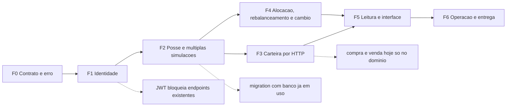

# Roadmap do Portfy

Sequência executável para levar o Portfy do estado atual até o MVP completo. Não é uma lista de desejos: cada etapa tem **arquivos**, **passos**, **critério de aceite** e **gate**.

- **Autoridade da regra:** `docs/arch.md` decide arquitetura, schema, regras financeiras e dívida. Este documento decide **ordem** e **critério de fechamento** — não inventa regra nova.
- **Autoridade do que existe:** `docs/arch.md` §4 (baseline medido) e `docs/funcionalidades.md`.
- **Autoridade das classes a criar:** `docs/diagrama-classe-candidatas.md` (ondas 1 a 5).
- **Autoridade dos fluxos:** `docs/diagrama.md`.
- **Baseline verificado em 2026-11-01**, commit `34f2657`.

> **Nota de consistência:** `docs/funcionalidades.md` foi alinhado ao código em 2026-11-01 (base `34f2657`) — §1, §3, §4, §5, §6, §7, §9, §11, §12 e §13 foram corrigidos para refletir o SQLite como autoridade de estado, os 66 testes e as rotas reais. Se algum documento de `docs/` divergir do código, a regra é a mesma: o código vence e o documento é corrigido na mesma alteração.

---

## 1. Estado de partida (medido, não presumido)

| Item | Situação |
|---|---|
| `dotnet build Portfy.csproj` | 0 erros, 0 warnings |
| `dotnet test tests/Portfy.Tests` | 89 testes, 0 falhas |
| `npm run build` / `npm run lint` | verdes / 0 erros |
| Persistência | SQLite + EF Core, migration `InitialCreate`, 7 `Configurations`, seed idempotente |
| Autoridade de estado | única (`AppDbContext`); zero `private static` em `Controllers`/`Services` |
| Injeção de dependência | 7 contratos em `Services/Contracts/`, serviços com estado `Scoped`, `IGeradorDeVariacao`/`ISenhaHasher` `Singleton` |
| Dívidas P0 | todas fechadas (`arch.md` §20) |

**O que ainda não existe** (é o escopo deste roadmap): `Dtos/` e `Middleware/` para os recursos que não sejam usuário (o cadastro de usuário já foi migrado), autenticação, múltiplas simulações, alocação-meta, rebalanceamento, câmbio, compra/venda por HTTP, relatório por API, telas de carteira/ativo/orçamento, CI e Docker.

---

## 2. Regras de execução

1. **Uma etapa = um commit** (ou um PR), com os gates de `arch.md` §18 verdes antes e depois.
2. **Etapa só fecha com o aceite verificado** — não com "código escrito". Se o aceite não é verificável por comando ou por requisição, o aceite está mal escrito: reescreva.
3. **Não abrir etapa com dependência pendente** (§3 e §4). A ordem existe porque migration, contrato e frontend mudam juntos.
4. **Mudou schema → migration no mesmo commit** (`dotnet ef migrations add <Nome> -o Data/Migrations`).
5. **Mudou contrato JSON → tipo espelho no SPA no mesmo commit** (`arch.md` §10, item 7).
6. **Regra de negócio nova → teste no mesmo commit** (`arch.md` §21, item 3).
7. Ao concluir a etapa, marcar `✅` na tabela da fase **e** atualizar `docs/funcionalidades.md`; se a etapa criou classe prevista, mover de `criar` para `existe` em `docs/diagrama-classe-candidatas.md`.
8. **Etapa bloqueada vira `⚠` com o motivo**, nunca "quase pronta".

---

## 3. Mapa das fases

| Fase | Objetivo | Entrega principal | Depende de |
|---|---|---|---|
| **F0** | Contrato de API e erro uniforme | `Dtos/`, `Middleware/`, `IClock`, higiene de `Models/`, espelho no SPA | — |
| **F1** | Identidade e acesso | JWT, hash parametrizado, rate limit, logout no SPA | F0 |
| **F2** | Posse e múltiplas simulações | `CarteiraSimulada.UsuarioId/Nome`, CRUD, clonagem | F1 |
| **F3** | Carteira operável por HTTP | compra, venda e aporte que altera saldo | F2 |
| **F4** | Alocação, rebalanceamento e câmbio | `AlocacaoMeta`, `RebalanceamentoService`, `CambioService` | F2 |
| **F5** | Leitura e interface | relatório por DTO, indicador, telas e gráfico | F3, F4 |
| **F6** | Operação e entrega | CORS por config, CI, Docker, higiene final | F5 |

Status atual: **F1/E1.1 concluída** (hash de senha em BCrypt); **E0.1 e E0.2 parciais** (recurso usuário); demais pendentes.

---

## 4. Grafo de dependências

As arestas pontilhadas são os pontos de atenção, detalhados em §8.

---

## 5. Fases e etapas

### F0 — Contrato de API e erro uniforme

Sem `Dtos/` e sem middleware, toda feature nova multiplicaria `new { Mensagem }` e `try/catch` por action. Fechar isso antes é o que impede o resto do roadmap de piorar o código.

#### E0.1 — Criar `Dtos/` e remover DTO aninhado dos controllers — ⚠ parcial (usuário feito em 2026-11-01)

- **Depende:** — · **Fecha:** ADR-004, dívida §6.2 linha 2 e 3
- **Feito:** `Dtos/Usuario/` com `CadastroRequest`, `LoginRequest`, `AtualizarUsuarioRequest`, `AtualizarSalarioRequest`, `AlterarSenhaRequest` e respostas tipadas; `UsuarioController` sem DTO aninhado nem `new { }`.
- **Pendente:** `Dtos/Ativo/`, `Dtos/Carteira/`, `Dtos/Aporte/`, `Dtos/Orcamento/` e a conversão dos demais controllers.
- **Arquivos:** `Dtos/Usuario/`, `Dtos/Ativo/`, `Dtos/Carteira/`, `Dtos/Aporte/`, `Dtos/Orcamento/`; `Controllers/*.cs`
- **Passos:**
  1. Um arquivo por DTO de entrada e um por DTO de resposta, por recurso.
  2. `DataAnnotations` para forma (`[Required]`, `[Range]`) — validação de negócio **não** entra aqui.
  3. Substituir `public class XRequest` aninhado nos controllers pelo tipo em `Dtos/`.
  4. Substituir todo `return Ok(new { ... })` por DTO nomeado.
  5. Conferir que nenhum DTO expõe `SenhaHash`.
- **Aceite:** `grep -rn "new {" Controllers` vazio; resposta de cada endpoint idêntica em campos à anterior.
- **Gate:** `dotnet build` + smoke de 1 requisição por verbo.

#### E0.2 — Middleware único de erro com ProblemDetails — ⚠ parcial (usuário feito em 2026-11-01)

- **Depende:** E0.1 · **Fecha:** ADR-005, P1-c, dívida §6.2
- **Feito:** `Middleware/ExceptionHandlingMiddleware.cs` registrado em `Program.cs`; `UsuarioController` sem `try/catch`; mapa completo de exceções implementado e testado.
- **Pendente:** os demais controllers ainda têm `try/catch` e envelope `{ Mensagem }` (P1-c aberta para eles).
- **Arquivos:** `Middleware/ExceptionHandlingMiddleware.cs`, `Program.cs`, `Controllers/*.cs`
- **Passos:**
  1. Middleware traduz: `ArgumentException`/`ArgumentOutOfRangeException` → 400, `KeyNotFoundException` → 404, `InvalidOperationException` → 422, `DbUpdateException` de unicidade → 409, resto → 500 sem stack trace.
  2. Registrar **antes** de `UseCors`/`MapControllers` em `Program.cs`.
  3. Remover os 7 `try/catch` dos controllers; action não trata exceção.
  4. Mensagens em pt-BR no `detail`, sem dado sensível.
- **Aceite:** `grep -rn "catch" Controllers` vazio; compra sem saldo responde `422` com `ProblemDetails`.
- **Gate:** `dotnet build` + 1 requisição que force cada faixa de erro.

#### E0.3 — `IClock` e remoção de `DateTime.Now` do domínio

- **Depende:** — · **Fecha:** P2-d, ADR-013
- **Arquivos:** `Services/Contracts/IClock.cs`, `Services/RelogioSistema.cs`, `Models/Usuario.cs`, `Models/AporteSimulado.cs`, `Program.cs`, `Data/Configurations/*`
- **Passos:**
  1. `interface IClock { DateTime Agora { get; } }` e implementação usando `DateTime.UtcNow`.
  2. Domínio recebe data por parâmetro; construtor de domínio deixa de ler o relógio.
  3. Registrar como `Singleton` (sem estado).
  4. Ajustar os testes que dependiam de `DateTime.Now` para injetar data fixa.
- **Aceite:** `grep -rn "DateTime.Now" --include="*.cs" Models Services Controllers Data` vazio; testes verdes.
- **Gate:** `dotnet test`.

#### E0.4 — Higiene do domínio

- **Depende:** — · **Fecha:** P2-b, P2-c
- **Arquivos:** `Models/Posicao.cs`, `Models/CarteiraSimulada.cs`, `Models/Ativos/*.cs`
- **Passos:**
  1. Extrair `Posicao` de `Models/CarteiraSimulada.cs` para `Models/Posicao.cs`, apagando o arquivo comentado.
  2. Ajustar `namespace Portfy.Models.Ativos` em `Models/Ativos/` e os `using` afetados.
  3. `Posicao.ValorAtual()` passa a ser a única conta de valor da posição; `CalcularPatrimonioTotal` e o relatório passam a chamá-la.
- **Aceite:** uma classe pública por arquivo; `grep -rn "namespace Portfy.Models;" Models/Ativos` vazio; testes verdes.
- **Gate:** `dotnet build` + `dotnet test`.

#### E0.5 — Espelho do contrato no SPA

- **Depende:** E0.1, E0.2 · **Fecha:** `arch.md` §10 item 7
- **Arquivos:** `frontend/src/types/*.ts`, `frontend/src/services/api.ts` → `http.ts`
- **Passos:**
  1. Mover as interfaces de `UsuarioService.ts` e `AtivoService.ts` para `src/types/`.
  2. Renomear `services/api.ts` para `services/http.ts`.
  3. Interceptor lê `ProblemDetails.detail` apenas — o envelope legado deixa de existir após E0.2.
- **Aceite:** `npm run build` e `npm run lint` verdes; nenhuma tela importa `axios`.
- **Gate:** `cd frontend && npm run build && npm run lint`.

---

### F1 — Identidade e acesso

Hoje qualquer cliente alcança qualquer `id` e o login não emite credencial (`arch.md` §15, item 4). Enquanto isso não fecha, toda feature de carteira nasce sem dono.

#### E1.1 — `ISenhaHasher` e BCrypt — ✅ executado em 2026-11-01

- **Depende:** F0 · **Fecha:** P1-d, `arch.md` §13 item 5 · **ADR:** [ADR-018](arch.md#19-decisões-vinculantes)
- **Arquivos:** `Services/Contracts/ISenhaHasher.cs`, `Services/SenhaHasher.cs`, `Models/Usuario.cs`, `Services/UsuarioService.cs`, `Program.cs`
- **Passos:**
  1. ✅ Extrair `CriarHashSenha`/`VerificarSenha` de `Usuario` para `SenhaHasher`.
  2. ✅ BCrypt com fator de trabalho 12 (2^12 rodadas internas) e salt por hash; substitui a meta de 210.000 iterações de PBKDF2, conforme ADR-018.
  3. ✅ `Usuario` recebe `SenhaHash` pronto e expõe `AlterarSenhaHash`; verificação e regravação ficam no `UsuarioService`.
  4. ✅ Teste de hash legado: hash PBKDF2 de 100k continua verificando e é regravado em BCrypt no primeiro login válido.
- **Aceite:** ✅ `grep -rn "Rfc2898DeriveBytes" Models` vazio (a verificação legada vive em `Services/SenhaHasher.cs`); login com usuário anterior funciona.
- **Gate:** ✅ `dotnet test` — 89/89 casos.

#### E1.2 — JWT: emitir, validar e exigir

- **Depende:** E1.1 · **Fecha:** P1-a, ADR-010
- **Arquivos:** `Program.cs`, `Services/Contracts/IAuthService.cs`, `Services/AuthService.cs`, `Dtos/Usuario/LoginResponse.cs`, `Controllers/UsuarioController.cs`, `Controllers/CarteiraController.cs`
- **Passos:**
  1. `AddAuthentication(JwtBearer)` + `AddAuthorization`; chave de assinatura vinda de configuração/ambiente, nunca do repositório.
  2. `POST api/usuarios/login` devolve `{ token, expiraEm, usuario }`.
  3. `[Authorize]` em carteira, aporte, orçamento e nos endpoints de usuário que dependem do próprio `id`.
  4. Identidade lida do token (`ClaimTypes.NameIdentifier`), nunca do `id` da URL.
  5. `UseAuthentication()` **antes** de `UseAuthorization()`.
- **Aceite:** sem token → `401`; com token de outro usuário → `403`; `grep -rn "\[Authorize\]" Controllers` com os recursos protegidos.
- **Gate:** smoke de `401`/`403`/`200` por recurso.

#### E1.3 — Rate limiting no login

- **Depende:** E1.2 · **Fecha:** P1-g, `arch.md` §15 item 6
- **Arquivos:** `Program.cs`
- **Passos:**
  1. Política por IP + login com janela deslizante.
  2. Resposta `429` com `Retry-After`.
- **Aceite:** 11ª tentativa em sequência recebe `429`.
- **Gate:** script de 11 chamadas registrado no relatório da mudança.

#### E1.4 — SPA: sessão, cabeçalho e saída

- **Depende:** E1.2 · **Fecha:** `arch.md` §15 item 4, lacuna §11 do `diagrama.md`
- **Arquivos:** `frontend/src/services/http.ts`, `frontend/src/App.tsx`, `frontend/src/Dashboard.tsx`
- **Passos:**
  1. Interceptor de requisição adiciona `Authorization: Bearer`.
  2. `401` limpa a sessão e volta para login (não deixa tela em branco).
  3. Botão de sair no Dashboard; `App.tsx` ganha a transição `dashboard → login`.
  4. Substituir `localStorage.usuarioLogado` como fonte de identidade — ele passa a ser só cache de UI.
- **Aceite:** token expirado leva a login com mensagem; logout limpa `localStorage`.
- **Gate:** `npm run build && npm run lint`.

---

### F2 — Posse e múltiplas simulações

O delta de modelagem da onda 1 (`diagrama-classe-candidatas.md` §3). Sem ele não existe "minha carteira", só "a carteira".

#### E2.1 — Migration de posse

- **Depende:** F1 · **Fecha:** `arch.md` §9.1, onda 1
- **Arquivos:** `Models/CarteiraSimulada.cs`, `Models/AporteSimulado.cs`, `Models/Orcamento.cs`, `Data/Configurations/*`, `Data/Migrations/*`
- **Passos:**
  1. `CarteiraSimulada`: `UsuarioId`, `Nome`.
  2. `Posicao`: `CarteiraId` e `AtivoId` explícitos (saem de *shadow property*).
  3. `AporteSimulado`: `CarteiraId` (hoje anulável por ausência no domínio).
  4. `Orcamento`: `UsuarioId`, `EhFixo`.
  5. `dotnet ef migrations add PosseDaCarteira -o Data/Migrations` + `database update` em banco limpo **e** em banco com dados.
  6. Seed: carteira e orçamento padrão associados ao usuário de seed, ou removidos do seed se o fluxo passar a criar por usuário.
- **Aceite:** banco novo e banco existente sobem sem erro; `Posicoes` e `Aportes` com FK não nula.
- **Gate:** `dotnet build` + `dotnet test` + `database update` nos dois cenários.

#### E2.2 — Carteira por usuário e CRUD

- **Depende:** E2.1 · **Fecha:** `arch.md` §2.2 (múltiplas simulações)
- **Arquivos:** `Services/CarteiraService.cs`, `Services/Contracts/ICarteiraService.cs`, `Controllers/CarteiraController.cs`, `Dtos/Carteira/*`
- **Passos:**
  1. `ICarteiraService` passa a receber `usuarioId`.
  2. `GET/POST/PUT/DELETE api/carteiras` — criação com saldo inicial, renomeação, exclusão com confirmação de regra.
  3. Remover dependência de `SeedInicial.CarteiraPadraoId` no caminho de leitura.
  4. Teste de isolamento: usuário A não enxerga carteira de B.
- **Aceite:** dois usuários com carteiras distintas; carteira de outro usuário responde `404`/`403`.
- **Gate:** `dotnet test` + smoke por usuário.

#### E2.3 — Clonagem de simulação

- **Depende:** E2.2 · **Fecha:** `arch.md` §2.2 (clonagem)
- **Arquivos:** `Services/CarteiraService.cs`, `Controllers/CarteiraController.cs`
- **Passos:**
  1. `POST api/carteiras/{id}/clonar` cria cópia com `Id` novo, mesmo `UsuarioId`, nome derivado.
  2. Copiar posições e alocações, **sem** IDs; aportes não são copiados (histórico).
  3. Transação única.
- **Aceite:** clone tem as mesmas posições e nenhum aporte; falha no meio não deixa carteira parcial.
- **Gate:** `dotnet test` (teste de atomicidade).

---

### F3 — Carteira operável por HTTP

O buraco mais grave do produto: `ComprarAtivo`/`VenderAtivo` existem, são testados e **nenhum endpoint os chama** (`diagrama.md` §11, item 1). Aporte também não altera saldo (§11, item 2).

#### E3.1 — Endpoint de compra

- **Depende:** F2 · **Fecha:** funcionalidade central ausente
- **Arquivos:** `Services/Contracts/ICarteiraService.cs`, `Services/CarteiraService.cs`, `Controllers/CarteiraController.cs`, `Dtos/Carteira/CompraRequest.cs`
- **Passos:**
  1. `POST api/carteiras/{id}/compras` com `ticker` e `quantidade`.
  2. Serviço carrega carteira e ativo do banco, chama `ComprarAtivo` e faz `SaveChanges`.
  3. Sem saldo → `InvalidOperationException` → `422` pelo middleware de E0.2.
  4. Teste de integração: compra grava posição e reduz saldo no SQLite.
- **Aceite:** `200`/`201` com posição criada; segunda compra recalcula preço médio; saldo insuficiente → `422`.
- **Gate:** `dotnet test` + smoke real.

#### E3.2 — Endpoint de venda

- **Depende:** E3.1 · **Fecha:** simetria da operação
- **Passos:**
  1. `POST api/carteiras/{id}/vendas` simétrico à compra.
  2. Venda zera posição → posição removida.
  3. Venda maior que a posição → `422`.
- **Aceite:** saldo aumenta; posição zerada desaparece.
- **Gate:** `dotnet test`.

#### E3.3 — Aporte alimentando a carteira

- **Depende:** E2.1 · **Fecha:** `diagrama.md` §11, item 2
- **Arquivos:** `Services/AporteService.cs`, `Controllers/AporteController.cs`, `Dtos/Aporte/*`
- **Passos:**
  1. `AporteService.Criar` passa a receber `carteiraId` e chamar `CarteiraSimulada.AdicionarAporte`.
  2. Aporte e saldo mudam na **mesma** transação.
  3. `OrigemSalarioId` renomeado para `UsuarioId` (decisão aberta nº 3 de `diagrama-classe-candidatas.md`).
- **Aceite:** após `POST api/aportes`, `GET api/carteiras/{id}` mostra saldo anterior + valor; falha de escrita não deixa aporte órfão.
- **Gate:** `dotnet test` + smoke.

---

### F4 — Alocação, rebalanceamento e câmbio

As três funcionalidades do MVP que dependem de modelagem nova (`arch.md` §2.2). Só fazem sentido com carteira já possuída e operável.

#### E4.1 — `AlocacaoMeta` e a invariante dos 100%

- **Depende:** F2 · **Fecha:** `arch.md` §11 item 4, onda 2
- **Arquivos:** `Models/AlocacaoMeta.cs`, `Data/Configurations/AlocacaoMetaConfiguration.cs`, `Data/AppDbContext.cs`, `Models/CarteiraSimulada.cs`, `Data/Migrations/*`
- **Passos:**
  1. Entidade com `CarteiraId`, `AtivoId`, `PercentualAlvo`; índice único `(CarteiraId, AtivoId)`.
  2. `AlocacaoMeta` valida só a própria faixa (0–100).
  3. `CarteiraSimulada` ganha a coleção e o método que valida soma `100 ± 0,01`.
  4. Resíduo distribuído de forma determinística: ordenar por percentual decrescente, arredondar, resto na primeira.
- **Aceite:** soma `99,99` e `100,01` aceitas; `98` rejeitada; duas execuções do arredondamento geram o mesmo resultado.
- **Gate:** `dotnet test` com caso de resíduo.

#### E4.2 — `RebalanceamentoService` e `AporteSugerido`

- **Depende:** E4.1 · **Fecha:** `arch.md` §11 item 5, onda 2
- **Arquivos:** `Models/AporteSugerido.cs`, `Services/RebalanceamentoService.cs`, `Controllers/CarteiraController.cs`, `Dtos/Carteira/RebalanceamentoResponse.cs`
- **Passos:**
  1. `record AporteSugerido(AtivoId, Ticker, ValorSugerido, QuantidadeSugerida)`.
  2. `CalcularAportes(patrimonioPorAtivo, metas, valorAporte) → IReadOnlyList<AporteSugerido>`, puro: sem `DbContext`, sem `Random`, sem relógio.
  3. `POST api/carteiras/{id}/rebalanceamento` recebe valor e devolve a sugestão.
  4. Teste: carteira vazia distribui proporcional às metas; valor zero devolve lista vazia.
- **Aceite:** soma dos `ValorSugerido` igual ao aporte com tolerância de `0,01`; mesma entrada, mesma saída.
- **Gate:** `dotnet test`.

#### E4.3 — Simulador "e se?" sem persistir

- **Depende:** E4.1 · **Fecha:** ADR-017, `arch.md` §2.2
- **Arquivos:** `Controllers/CarteiraController.cs`, `Dtos/Carteira/SimulacaoRequest.cs`
- **Passos:**
  1. `POST api/carteiras/{id}/simulacao` recebe metas hipotéticas e devolve a visão resultante.
  2. Nenhuma escrita: sem `SaveChanges`, sem `Add`/`Update`.
- **Aceite:** duas chamadas seguidas com as mesmas metas produzem o mesmo resultado e o banco fica inalterado (`ChangeTracker` sem entidades modificadas).
- **Gate:** `dotnet test` provando ausência de escrita.

#### E4.4 — `Pais`/`Moeda`, `CotacaoCambio` e `CambioService`

- **Depende:** E2.1 · **Fecha:** ADR-015, onda 3
- **Arquivos:** `Models/Ativos/Ativo.cs`, `Models/CotacaoCambio.cs`, `Services/Contracts/ICambioService.cs`, `Services/CambioService.cs`, `Data/Configurations/*`, `Data/Seed/SeedInicial.cs`, `Data/Migrations/*`
- **Passos:**
  1. `Ativo.Pais` (ISO 3166) e `Ativo.Moeda` (ISO 4217) — TPH recebe as colunas.
  2. `CotacaoCambio` com par origem/destino único e `Fator > 0`.
  3. `CambioService.Converter` é a **única** função de conversão; moeda sem cotação → `422`.
  4. Seed com cotações manuais (`USD/BRL`) e ativos com país/moeda.
- **Aceite:** conversão de ativo em USD para BRL com fator do banco; moeda desconhecida falha explicitamente.
- **Gate:** `dotnet test` + `database update`.

---

### F5 — Leitura e interface

Até aqui a API sabe fazer; o produto ainda não mostra. Esta fase fecha o funil 16 rotas → 6 usadas (`funcionalidades.md` §10).

#### E5.1 — Relatório consolidado por DTO

- **Depende:** F3, F4 · **Fecha:** P2-a, ADR-012
- **Arquivos:** `Services/RelatorioFinanceiroService.cs`, `Dtos/Relatorio/*`, `Controllers/RelatorioController.cs`, remoção de `Services/RelatorioFinanceiro.cs`
- **Passos:**
  1. Serviço de leitura recebe `usuarioId` e `carteiraId`, monta o DTO.
  2. Visão macro (investimentos × despesas) e micro (por ativo e por categoria) no mesmo DTO.
  3. Formatação de moeda fica no SPA — backend devolve `decimal`.
  4. Apagar `RelatorioFinanceiro.cs` (console).
- **Aceite:** `grep -rn "Console\." Services` vazio; `GET api/relatorios/carteiras/{id}` responde o consolidado.
- **Gate:** `dotnet test` + smoke.

#### E5.2 — Indicador de taxa de poupança

- **Depende:** E5.1 · **Fecha:** `arch.md` §2.2
- **Arquivos:** `Services/IndicadorService.cs`, `Dtos/Relatorio/IndicadorDto.cs`
- **Passos:**
  1. `CalcularTaxaPoupanca(totalInvestido, totalAportado)`.
  2. Borda: `totalAportado == 0` devolve `0` sem divisão por zero.
  3. Integrar ao DTO do relatório.
- **Aceite:** teste de borda e teste de valor nominal.
- **Gate:** `dotnet test`.

#### E5.3 — Estrutura do SPA (`pages`, `components`, `types`)

- **Depende:** E0.5 · **Fecha:** `arch.md` §8.2/§8.3, dimensão K da AV1
- **Arquivos:** `frontend/src/pages/*`, `frontend/src/components/*`, `frontend/src/types/*`
- **Passos:**
  1. Mover `Login`, `Cadastro`, `Dashboard` para `src/pages/<Tela>/` com CSS co-localizado.
  2. `App.css`/`index.css` → `src/styles/global.css`.
  3. Decidir destino de `components/Ativos.tsx` (importar ou remover) e de `usuarioService.obterTodos` (usar ou remover).
  4. Router só quando houver **mais de 3 telas** (ADR-011).
- **Aceite:** `npm run build && npm run lint` verdes; nenhuma regressão visual nas 3 telas.
- **Gate:** build + lint.

#### E5.4 — Dashboard com dados reais

- **Depende:** E5.1, E3.1, E3.3 · **Fecha:** cards fixos em `R$ 0,00`, menu com `href="#"`
- **Arquivos:** `frontend/src/pages/Dashboard/Dashboard.tsx`
- **Passos:**
  1. Cards de saldo, patrimônio e total investido vindos da API.
  2. Painéis de orçamentos, investimentos e aportes com os três estados (carregando/erro/vazio).
  3. Seletor de simulação (lista de carteiras do usuário) alimentado por E2.2.
  4. Menu lateral com rotas reais ou remoção dos itens sem tela.
- **Aceite:** nenhum valor monetário literal no JSX; erro aparece em tela.
- **Gate:** build + lint + smoke com usuário real.

#### E5.5 — Gráfico de pizza

- **Depende:** E5.1, E4.1 · **Fecha:** `arch.md` §3.1 (dimensão visual do MVP)
- **Arquivos:** `frontend/package.json`, `frontend/src/components/GraficoAlocacao/*`
- **Passos:**
  1. Só agora adicionar `Recharts` (ou `Chart.js`) ao `package.json`, com ADR de registro.
  2. Dados vêm do DTO do relatório; nenhum cálculo financeiro no componente.
  3. Legenda com percentual e valor; estado vazio quando não há metas.
- **Aceite:** percentuais do gráfico somam 100% e batem com o DTO.
- **Gate:** build + lint.

---

### F6 — Operação e entrega

#### E6.1 — CORS e `AllowedHosts` por configuração

- **Depende:** E1.2 · **Fecha:** P1-e, `arch.md` §15 itens 1 e 2
- **Arquivos:** `Program.cs`, `appsettings.json`, `appsettings.Development.json`
- **Passos:**
  1. Origens e hosts vêm de configuração por ambiente; `"*"` remove-se.
  2. `appsettings.Development.json` passa a existir só com o que é de desenvolvimento.
- **Aceite:** origem fora da lista recebe bloqueio; startup sem `"*"`.
- **Gate:** smoke de preflight CORS.

#### E6.2 — `.env.example` e base URL do SPA

- **Depende:** E0.5 · **Fecha:** P2-e
- **Passos:**
  1. `VITE_API_BASE_URL` lida em `services/http.ts`, sem literal.
  2. `frontend/.env.example` documentando a variável.
- **Aceite:** `grep -rn "localhost:5000" frontend/src` vazio.
- **Gate:** build com e sem a variável definida.

#### E6.3 — CI com os gates obrigatórios

- **Depende:** F5 · **Fecha:** `arch.md` §4 (Docker/CI inexistentes)
- **Passos:**
  1. Workflow com `dotnet build`, `dotnet test`, `npm ci`, `npm run build`, `npm run lint`.
  2. `database update` em banco limpo como job separado, provando reprodutibilidade do schema.
  3. Falha de qualquer gate bloqueia merge.
- **Aceite:** pipeline verde no PR de teste e vermelho quando um gate é quebrado de propósito.
- **Gate:** execução real do workflow, com o resultado registrado.

#### E6.4 — Dockerfile

- **Depende:** E6.3
- **Passos:**
  1. Build multi-stage do backend; `portfy.db` fora da imagem (volume).
  2. Documentar a execução no `README.md`.
- **Aceite:** container sobe e responde `GET api/carteiras` após `database update`.
- **Gate:** `docker build` + smoke no container.

#### E6.5 — Higiene final

- **Depende:** F5 · **Fecha:** P2-f, P2-g
- **Passos:**
  1. Rotas em minúsculas e plural (`api/usuarios`, `api/carteiras`), com o SPA atualizado no mesmo commit.
  2. Comentários didáticos extensos dos controllers reduzidos ao "por quê".
- **Aceite:** `grep -rn "api/\[controller\]" Controllers` vazio; SPA funcionando com as rotas novas.
- **Gate:** build + lint + smoke de todos os recursos.

---

## 6. Rastreabilidade: etapa → dívida → funcionalidade

| Etapa | Fecha dívida (`arch.md` §20) | Entrega funcionalidade do MVP |
|---|---|---|
| E0.1 | §6.2 (DTO aninhado) | ⚠ usuário feito (2026-11-01) |
| E0.2 | P1-c | ⚠ usuário feito (2026-11-01) |
| E0.3 | P2-d | — |
| E0.4 | P2-b, P2-c | — |
| E0.5 | — | contrato espelhado no SPA |
| E1.1 | P1-d | ✅ 2026-11-01 (ADR-018) |
| E1.2 | P1-a | — |
| E1.3 | P1-g | — |
| E1.4 | — | sessão, cabeçalho e logout no SPA |
| E2.1 | — | múltiplas simulações (base) |
| E2.2 | — | seletor de perfil |
| E2.3 | — | clonagem de simulação |
| E3.1 | — | compra de ativos por HTTP |
| E3.2 | — | venda de ativos por HTTP |
| E3.3 | — | aporte afetando a carteira |
| E4.1 | — | alocação-meta (pizza) |
| E4.2 | — | rebalanceamento automático |
| E4.3 | — | simulador "e se?" |
| E4.4 | — | ativos globais e câmbio |
| E5.1 | P2-a | visão consolidada macro/micro |
| E5.2 | — | taxa de poupança |
| E5.3 | — | organização do frontend |
| E5.4 | — | dashboard com dados reais |
| E5.5 | — | gráfico de pizza |
| E6.1 | P1-e | — |
| E6.2 | P2-e | — |
| E6.3 | — | CI |
| E6.4 | — | empacotamento |
| E6.5 | P2-f, P2-g | — |

---

## 7. Critérios de aceite transversais

Toda etapa, sem exceção (`arch.md` §21):

1. `dotnet build` 0 erros e sem warning novo.
2. `dotnet test` 0 falhas — teste novo para cada regra nova.
3. `npm run build && npm run lint` verdes quando o SPA foi tocado.
4. Migration versionada quando o schema mudou, aplicada em banco limpo **e** em banco com dados.
5. Contrato de API espelhado em `frontend/src/types/` no mesmo commit.
6. Nenhum `TODO` silencioso, `catch` vazio, código comentado ou teste desabilitado.
7. Saída dos gates registrada no relatório da mudança.

---

## 8. Riscos e armadilhas por etapa

| Etapa | Risco | Mitigação |
|---|---|---|
| E1.2 | Ativar `[Authorize]` quebra o SPA que não envia token | Fazer E1.4 no **mesmo** PR; liberar Swagger em Development |
| E2.1 | Migration em banco já em uso deixa FK nula | Backfill antes de tornar `CarteiraId` obrigatório: atribuir a carteira padrão ao usuário existente |
| E2.1 | Seed com `UsuarioId` fixo quebra em instalação nova | Seed cria usuário e carteira na mesma migration |
| E3.1 | `lock` de `CarteiraSimulada` não protege concorrência entre requisições | Concorrência é do `DbContext` + transação (`arch.md` §9, item 3); não confiar no `lock` |
| E4.2 | Arredondamento do resíduo divergir entre execuções | Ordenação determinística por percentual decrescente (`arch.md` §11, item 4) |
| E5.5 | Gráfico virar fonte de cálculo financeiro | Componente só desenha o DTO; cálculo é do servidor (`arch.md` §11, item 2) |
| E6.3 | CI verde localmente e vermelho no runner | Rodar `database update` em banco limpo antes de considerar a etapa fechada |

---

## 9. O que **não** está no roadmap

Fora do escopo do MVP por decisão registrada (`arch.md` §2.4 e §22): cotação em tempo real por API externa, câmbio automático, histórico de preços (`AtivoHistorico`), `Despesa` datada (ADR-014), 2FA/autenticação social, notificações, observabilidade/métricas, deploy em nuvem, versionamento de API pública, internacionalização.

Entram apenas com funcionalidade escrita em `notas/importante/sugestoes_mvp_portfy_temp_outubro_2026.md` e ADR correspondente.

---

## 10. Manutenção

1. Etapa concluída → marcar `✅` na tabela da fase e preencher a data.
2. Etapa bloqueada → `⚠` com o motivo e o que a desbloqueia.
3. Etapa nova só entra se: (a) estiver na lista de funcionalidades do MVP, ou (b) fechar dívida de `arch.md` §20. Ideia solta vira proposta em `notas/`, não etapa aqui.
4. Divergência entre este roadmap e `arch.md` se resolve **a favor de `arch.md`**: aqui é a ordem, lá é a regra.
